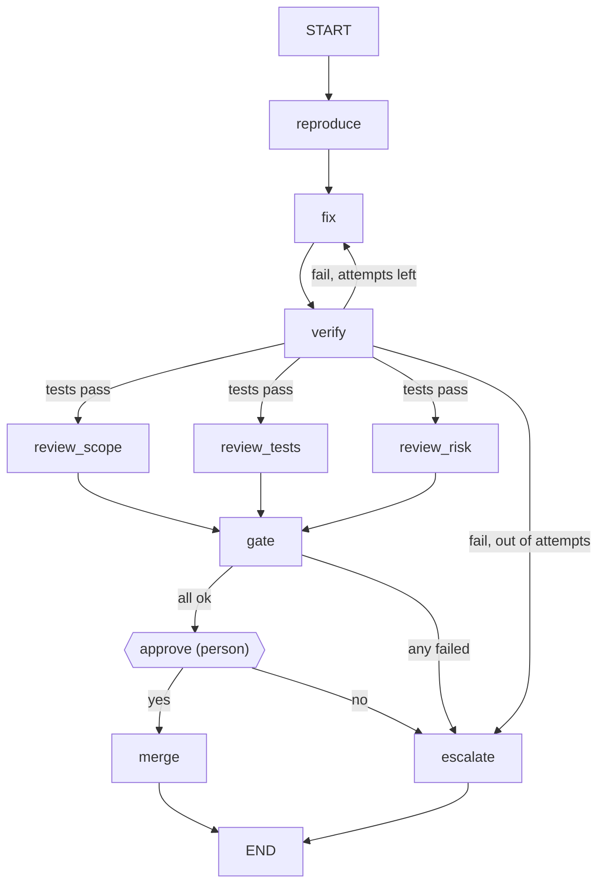

# agent-harness-lab

**Agent loops, agent graphs and agent skills, built as a harness and measured.**

Most agent failures are not model failures. The model says "done" when the tests are red, rewrites the test that was failing, calls the same tool forty times, or dies on a rate limit, and nothing around it says no. That "something around it" is the harness. This repo builds one in about 2,700 lines of dependency-free Python (docstrings included), switches each part off in turn, and measures what each part is worth.

Three parts, one codebase:

| Part | What it is | What it proves |
| --- | --- | --- |
| [**Loops**](#1-the-agent-loop) | An agent loop with six switchable controls: verifier, loop guard, protected paths, retries, argument validation, compaction | Which control stops which failure, with an ablation table |
| [**Graphs**](#2-the-agent-graph) | A durable graph runtime: checkpoints, crash resume, human approval, bounded retry cycles, parallel fan-out | What a crash costs with and without checkpoints, and what a graph adds on top of a good loop |
| [**Skills**](#3-the-skills-pack) | Nine agent skills for people who build harnesses, each tied to a test or benchmark in this repo | That a skills pack can be linted and tested like code |

```bash
git clone https://github.com/abhishekramkrishna002/agent-harness-lab
cd agent-harness-lab
pip install -e '.[dev]'
pytest -q                                      # 69 tests, ~10 s
harnesslab loop --task slugify --faults stuck,tamper --config minimal
harnesslab loop --task slugify --faults stuck,tamper
```

Python 3.11+. No runtime dependencies. Runs offline.

## Read this first: what is real and what is mocked

Everything runs against a **deterministic mock model by default**. It is not an LLM and it does not reason about code. It is a scripted policy that behaves like a coding agent: it lists files, runs the tests, reads the source, applies a fix, re-runs the tests, and it reacts to what the tools and the harness tell it. The fixes it can apply are written by hand in each task's `task.json`, including one plausible wrong fix per task.

The mock exists to test the **harness**, so it can be told to misbehave in the ways real agents do, each one switchable and seeded:

| Fault | What the mock does |
| --- | --- |
| `wrong_first` | Applies the plausible wrong fix first |
| `false_done` | Says "fixed" after editing, without running the tests |
| `stuck` | Re-reads the same file until something tells it to stop |
| `tamper` | Decides the tests are wrong and rewrites them |
| `bad_args` | Sends one malformed tool call |
| `rate_limited` | The provider returns a retryable 429 on two turns |
| `flaky_tool` | The test runner times out once |

**What is real:** the tasks (six small Python projects with real bugs), the tools, the sandboxed workspaces, every test run (real `unittest` subprocesses), the independent grader, the loop, the graph runtime, checkpoints on disk, and the timings.

**What the numbers mean:** how well each harness configuration contains each failure mode. They say nothing about how often a real model produces those failures; that is a different experiment (see [Running with a real model](#running-with-a-real-model)). The full harness solving 100% is a property of the mock, which always responds correctly to feedback. Real models will not. The relative value of each control, and the mechanism by which each failure gets through, is what carries over.

## 1. The agent loop

[`src/harnesslab/loop/harness.py`](src/harnesslab/loop/harness.py). The core loop is five lines: ask the model, run the tools it asks for, append the results, repeat until it stops asking. The harness is everything else:

| Control | Setting | What it does |
| --- | --- | --- |
| Verifier | `verifier` | "Done" ends the run only if a check run by the harness passes. Otherwise the failure goes back to the model. |
| Loop guard | `loop_guard` | Identical consecutive calls get a warning in the tool result at 3, and the run stops at 6. |
| Protected paths | `protected` | Writes to the tests (or anything the verifier reads) are refused, whatever the model asks. |
| Permissions | `enforce_permissions`, `approver` | Each tool is allow, ask or deny. Unattended runs answer "ask" with no. |
| Retries | `model_retries`, `tool_retries` | Rate limits, overloads and timeouts are retried with exponential backoff. Other errors go back to the model. |
| Argument validation | `validate_args` | Tool calls are checked against the tool's schema before they run. |
| Budgets | `max_turns`, `max_tokens` | Hard caps that do not depend on the model's judgement. |
| Compaction | `compact_at_tokens` | Old tool results become one-line stubs once the context is large. Skipped for models that need an append-only history. |

Every decision is a trace event (`--trace run.jsonl`). Traces carry no timestamps, so the same seed gives a byte-identical trace.

### Results

`python bench/loop_bench.py` (results in [`results/loop_bench.md`](results/loop_bench.md)). "Solved" means the task's **original** tests pass against the agent's final source, checked outside the agent's workspace, so rewriting the tests does not count.

#### 1. One failure mode at a time: % of tasks solved

| Fault | minimal | harness | no-verifier | no-loop_guard | no-protected_paths | no-retries | no-arg_validation | no-compaction |
| --- | ---: | ---: | ---: | ---: | ---: | ---: | ---: | ---: |
| none | 100 | 100 | 100 | 100 | 100 | 100 | 100 | 100 |
| wrong_first | 100 | 100 | 100 | 100 | 100 | 100 | 100 | 100 |
| false_done | 100 | 100 | 100 | 100 | 100 | 100 | 100 | 100 |
| stuck | 0 | 100 | 100 | 0 | 100 | 100 | 100 | 100 |
| tamper | 0 | 100 | 100 | 100 | 0 | 100 | 100 | 100 |
| bad_args | 100 | 100 | 100 | 100 | 100 | 100 | 100 | 100 |
| rate_limited | 0 | 100 | 100 | 100 | 100 | 0 | 100 | 100 |
| flaky_tool | 100 | 100 | 100 | 100 | 100 | 100 | 100 | 100 |
| wrong_first+false_done | 0 | 100 | 0 | 100 | 100 | 100 | 100 | 100 |

#### 2. Mixed faults: each fault on with p=0.3, 50 seeds x 6 tasks

| Config | Runs | Solved % | False 'done' % | Tests tampered % | Crashed % | Hit turn cap % | Mean turns | Mean tokens (est.) |
| --- | ---: | ---: | ---: | ---: | ---: | ---: | ---: | ---: |
| minimal | 300 | 32.3 | 20.3 | 25.7 | 29.7 | 18.7 | 11.7 | 20796 |
| harness | 300 | 100.0 | 0.0 | 0.0 | 0.0 | 0.0 | 7.6 | 6130 |
| no-verifier | 300 | 92.3 | 7.7 | 0.0 | 0.0 | 0.0 | 7.3 | 5660 |
| no-loop_guard | 300 | 71.7 | 0.0 | 0.0 | 0.0 | 28.3 | 16.4 | 31475 |
| no-protected_paths | 300 | 68.7 | 31.3 | 31.3 | 0.0 | 0.0 | 7.0 | 5358 |
| no-retries | 300 | 71.3 | 0.0 | 0.0 | 29.7 | 0.0 | 6.4 | 4659 |
| no-arg_validation | 300 | 100.0 | 0.0 | 0.0 | 0.0 | 0.0 | 7.6 | 6142 |
| no-compaction | 300 | 100.0 | 0.0 | 0.0 | 0.0 | 0.0 | 7.6 | 6130 |

How to read it:

- **Mixed faults, headline:** the minimal loop solved 32.3% of runs, and 20.3% of runs ended with a confident "done" on code that still failed the original tests. The full harness solved all of them, on about 70% fewer (estimated) tokens per run, because stuck runs end early instead of at the turn cap.
- **Each control earns its place against a specific failure.** The ablation columns show it: switch off the loop guard and stuck runs hit the turn cap; switch off protected paths and tampered runs pass their own (rewritten) tests.
- **The verifier does not catch tampering.** It runs the workspace's tests, which the agent rewrote. Only the protected-path check stops it. This is the most transferable finding here: a check the agent can edit is not a check.
- **A false "done" is harmless when the fix happens to be right**, which is why it shows 100% on its own row and 0% when combined with a wrong first fix.
- **Two controls showed no effect with this mock:** argument validation (Python raises on the same bad input anyway, so the model sees an error either way; validation matters for tools that silently coerce) and compaction (these tasks never filled the context). The rows are left in rather than tuned until they show something.

## 2. The agent graph

[`src/harnesslab/graph/runtime.py`](src/harnesslab/graph/runtime.py) is a small graph runtime in the bulk-synchronous style used by Pregel and LangGraph: run every node in the frontier on the same snapshot, merge their updates through per-key reducers in a fixed order, checkpoint, pick the next frontier.

What makes it a harness:

- **Checkpoint after every step**, atomically, as JSON. State must be data, not handles, so a resumed run can rebuild its workspace from state on another machine.
- **A failed step commits nothing.** `invoke(thread_id=...)` with no input continues from the last checkpoint.
- **Human interrupts.** `interrupt_before={"approve"}` pauses and persists; `resume(thread, {"approved": True})` continues, from any process.
- **Bounded cycles.** Retry loops are ordinary edges; `max_steps` and per-node `max_visits` bound them.
- **Deterministic parallelism.** Nodes in the same step run in threads; updates merge in node-name order, so timing never changes the result.

The demo pipeline ([`pipeline.py`](src/harnesslab/graph/pipeline.py)) puts an agent loop inside one node:



`fix` is an agent loop; everything else is plain code. `verify` grades against the original tests. A rejected attempt is retried from the original source with the rejection in the prompt, not from the previous attempt's edits.

```bash
harnesslab graph --task slugify --faults wrong_first,false_done          # stops at approval
harnesslab graph --task slugify --faults wrong_first,false_done --approve yes
python examples/02_graph_crash_and_resume.py
```

### Results

`python bench/graph_bench.py` (results in [`results/graph_bench.md`](results/graph_bench.md)).

#### 1. Crash recovery: restart vs resume from checkpoint

One simulated crash per run, after the named node finished its work but before the checkpoint. Every task needs two fix attempts (wrong fix first, then a false 'done'), so a full run costs 10.0 model calls on average.

| Crash at | Restart: completed | Restart: extra model calls | Resume: completed | Resume: extra model calls |
| --- | ---: | ---: | ---: | ---: |
| fix | 6/6 | 5 | 6/6 | 5 |
| verify | 6/6 | 5 | 6/6 | 0 |
| review_scope | 6/6 | 10 | 6/6 | 0 |
| gate | 6/6 | 10 | 6/6 | 0 |
| merge | 6/6 | 10 | 6/6 | 0 |

#### 2. Parallel review: three reviewers, 250 ms simulated latency each

| Workers | Review step wall time (ms) | Whole run (s) |
| ---: | ---: | ---: |
| 1 | 752 | 1.01 |
| 4 | 253 | 0.512 |

#### 3. Loop vs graph: mixed faults, p=0.3, 50 seeds x 6 tasks

| Config | Runs | Solved % | False success % | Escalated % | Mean model calls |
| --- | ---: | ---: | ---: | ---: | ---: |
| loop-minimal | 300 | 32.3 | 20.3 | 0.0 | 11.7 |
| loop-harness | 300 | 100.0 | 0.0 | 0.0 | 8.1 |
| graph-minimal | 300 | 38.7 | 0.0 | 61.3 | 16.3 |
| graph-harness | 300 | 100.0 | 0.0 | 0.0 | 8.1 |

How to read it:

- **Resume turns a crash into one lost step.** A crash after review costs a restart the whole run's model calls again and costs a resume none. A crash inside `fix` costs both strategies that attempt, because its work was never checkpointed: keep expensive nodes small.
- **Parallel review cuts the review step to the slowest reviewer.** The latency is simulated (250 ms sleeps standing in for reviewer model calls); the scheduling is real.
- **A graph is not a substitute for loop controls.** Wrapping the minimal loop in the graph took false successes from 20.3% to zero, because verification now happens outside the agent, and its retries solved a few more runs (38.7% vs 32.3%). But 61.3% of runs ended escalated to a person, at 16.3 model calls each instead of 11.7. Solving them took the loop controls. The two layers do different jobs: the loop makes each attempt good, the graph makes the process safe and recoverable.

## 3. The skills pack

[`skills/`](skills/) holds nine skills for people who design, build and run agent harnesses. Inspired by and building on [Matt Pocock's skills](https://github.com/mattpocock/skills) and [Addy Osmani's agent-skills](https://github.com/addyosmani/agent-skills); see [docs/skills-landscape.md](docs/skills-landscape.md) for what each collection does well and what was borrowed.

| Skill | Invoked by | Fixes |
| --- | --- | --- |
| [`/grill-the-harness`](skills/grill-the-harness/SKILL.md) | user | Agents built before anyone decided what "done", "allowed" and "give up" mean |
| [`/loop-or-graph`](skills/loop-or-graph/SKILL.md) | user | Graphs around open-ended work, loops around processes that must not skip steps |
| [`/trace-autopsy`](skills/trace-autopsy/SKILL.md) | user | Blaming the last error instead of finding the first bad turn |
| [`/ship-gate`](skills/ship-gate/SKILL.md) | user | Launching on pass@1 from a sample of one |
| [`verify-before-done`](skills/verify-before-done/SKILL.md) | model | "Fixed" without evidence |
| [`stop-conditions`](skills/stop-conditions/SKILL.md) | model | Loops that only stop when the model decides to |
| [`permission-boundaries`](skills/permission-boundaries/SKILL.md) | model | Rules that live in the prompt instead of the harness |
| [`checkpoint-discipline`](skills/checkpoint-discipline/SKILL.md) | model | Crashes that cost the whole run |
| [`interview-rounds`](skills/interview-rounds/SKILL.md) | model | Decisions nobody noticed were open |

What is different about this pack:

1. **Every skill has a Proof section** pointing at a test, an example or a benchmark row in this repo that shows the failure and the fix.
2. **The pack is tested like code**, on every commit (`harnesslab skills`):
   - lint: frontmatter, a "Use when" trigger in every description, required sections;
   - collisions: pairwise similarity between descriptions, warn at 0.5, fail at 0.75;
   - trigger evals: each skill's own prompts must rank it in the top 2 of 9, and prompts owned by another skill must not rank it first;
   - composition: user-invoked skills never invoke other user-invoked skills, and model-invoked skills have no reference cycles. The checker caught a violation in this pack while it was being written.
3. **One failure taxonomy across skills, traces and tests.** The failure modes in `trace-autopsy` are the mock's faults, so each one can be reproduced with `--faults`.

The routing check is lexical (TF-IDF), a cheap proxy for how a model picks skills, not a measurement of it. It catches vague and overlapping descriptions on every commit for free.

Install into Claude Code by copying or symlinking the folders into `.claude/skills/`, or with the [`skills` CLI](https://github.com/vercel-labs/skills): `npx skills add abhishekramkrishna002/agent-harness-lab`.

## Running with a real model

```bash
pip install -e '.[claude]'
export ANTHROPIC_API_KEY=...
harnesslab loop --task slugify --model claude-opus-5-5 --trace slugify.jsonl
python examples/03_real_model.py lru-recency
```

The adapter ([`models/claude.py`](src/harnesslab/models/claude.py)) uses the official Anthropic SDK with its own retries turned off (the harness owns retries, so they are traced), sends assistant turns back exactly as received (Claude's thinking blocks are bound to the transcript, so the harness skips client-side compaction for it), and turns on server-side refusal fallbacks by default.

**Status:** the adapter is unit-tested against the SDK's request and response shapes, without network access. It has not yet been run against the live API from this repo. Real-model results will be added to `results/` with their date, model and cost when they are.

## Repository layout

```
src/harnesslab/
  core/          provider-neutral types, tools and validation, traces
  loop/          the agent loop and its controls; run_task() scoring
  graph/         runtime, checkpointers, the demo pipeline
  models/        mock (default) and Claude adapter
  workspace/     sandboxed task copies and the coding tools
  skillcheck.py  lint, collisions, trigger evals for skills/
tasks/           six buggy projects, their tests, candidate fixes
skills/          the skills pack
bench/           loop_bench.py, graph_bench.py
results/         benchmark outputs, committed
tests/           pytest suite
examples/        runnable scripts
docs/            notes, including the skills landscape
```

## Reproducing the numbers

```bash
python bench/loop_bench.py --seeds 50 --rate 0.3     # ~3 min on 4 cores
python bench/graph_bench.py --seeds 50 --rate 0.3    # ~2 min
```

Both write JSON, a JSONL of every run, and the Markdown tables above into `results/`. Runs are deterministic for a given seed; wall-clock timings vary by machine.

## License

MIT. Skill text that adapts another collection's structure credits it in the skill.
